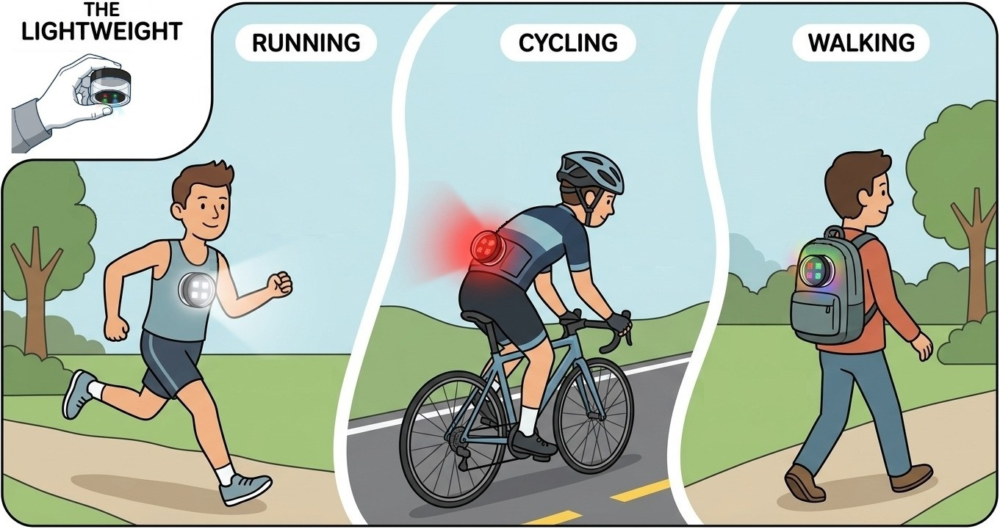
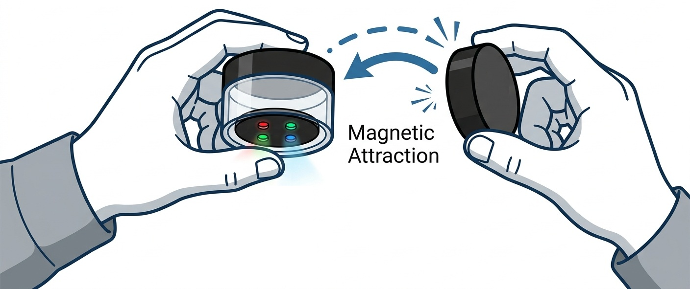
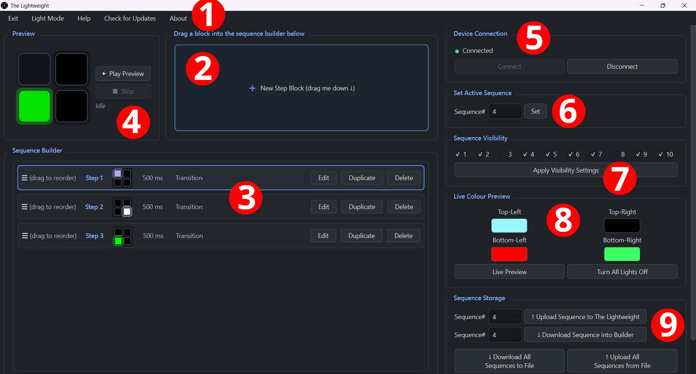
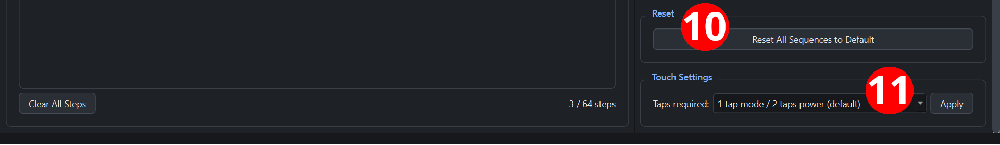

# The Lightweight - User Manual



The Lightweight is a running/cycling/walking light with four RGB (red, green, blue) lights arranged in a square. It can display up to ten sequences that are fully customisable using the software running on Windows or macOS by connecting the device via a standard USB-C cable. To access the USB-C port, unscrew the lid of the enclosure. The light is rechargeable with the same USB-C cable from a 5V DC power source such as a computer or phone charger. The Lightweight comes with a separate magnetic attachment so that it can be attached to clothing or a backpack.



## Table of Contents

- [Safety](#safety)
- [Device Operation](#device-operation)
- [The Lightweight - Sequence Programmer](#software-intro)
- [Installation](#installation)
  - [Windows](#windows)
  - [macOS](#macos)
- [Connecting Your Device](#connecting-your-device)
- [Interface Overview](#interface-overview)
- [Menu Bar](#menu-bar)
- [Building a Sequence](#building-a-sequence)
- [Previewing a Sequence](#previewing-a-sequence)
- [Working With the Device](#working-with-the-device)
  - [Device Connection](#device-connection)
  - [Set Active Sequence](#set-active-sequence)
  - [Set Sequence Visibility](#set-sequence-visibility)
  - [Live Colour Preview](#live-colour-preview)
  - [Upload / Download a Single Sequence](#upload--download-a-single-sequence)
  - [Download All / Upload All Sequences](#download-all--upload-all-sequences)
  - [Reset Sequences to Default](#reset-sequences-to-default)
  - [Touch Settings](#touch-settings)
- [The Sequence File Format](#the-sequence-file-format)
- [Troubleshooting](#troubleshooting)
- [Frequently Asked Questions (FAQ)](#frequently-asked-questions-faq)

---

<a id="safety"></a>
## ⚠️ Safety ⚠️

WARNING: THIS PRODUCT IS NOT A TOY. The Lightweight contains small parts, strong magnets and lithium polymer (LiPo) batteries that can pose severe fire hazards, choking hazards or life-threatening internal injuries if swallowed or mistreated. Keep the device and its magnetic attachment completely out of reach of children and pets, and away from pacemakers and medical implants. To prevent fire or injury, never puncture, crush, submerge in water or expose the device to extreme heat, and only charge it using a standard 5V DC power source. Please note that the battery will naturally self-discharge over time, so the device should be kept regularly charged to maintain optimal battery health. This is a safety light only - it is designed for visibility, not navigation. The beam is not focused enough to replace a proper torch for navigating unlit ground. By using this product, you acknowledge that the manufacturer accepts no responsibility or liability for any damages, injuries or losses incurred through misuse, failure to follow these safety instructions or operation outside of normal intended conditions.

## Device Operation

The Lightweight device can be operated independently of the computer using its built-in touch sensor at the centre of the clear plastic enclosure.

* **Power Toggle:** Tap the sensor to turn the device on or off (default setting is 2 taps).

* **Mode/Sequence Cycling:** Once the device is on, tap the sensor to cycle through sequences (default setting is 1 tap).

* **Tap timing:** Taps in a sequence must follow one another in quick succession (roughly under half a second apart) - pausing longer than that tells the device you've finished tapping and it acts on however many taps it counted. Holding the sensor down continuously for more than a couple of seconds cancels the tap sequence entirely, so a firm, quick tap works better than a long press.

* **Unplugging always powers the device off.** Whenever the USB-C cable is removed, the device shuts itself down completely, regardless of whether it was on or off at the time. After unplugging (e.g. once charging is finished), you'll need to perform a power-tap again to turn the light on.

* **Low-battery shutdown:** if the battery charge drops too low, the device automatically powers itself off to protect the battery.

* Plugging the device into a computer or charger will power its electronics on (so the software can connect to it and so it can charge) even if the light itself is off. The four RGB lights stay off until you turn the device on, either with a power tap or from the software. When the device is charging, a red light next to USB-C port will turn on and turn off when the device is fully charged. Charging the device's battery from 0% to 100% takes approximately 3 hours.

---

## The Lightweight - Sequence Programmer

This is a desktop application for designing, previewing and uploading custom lighting sequences to The Lightweight device over USB. Build animations visually by dragging colour-and-timing "step blocks" into a sequence, preview them, then push them straight to the device's memory.

**Requirements:**

- Windows 10/11 (64-bit) or macOS 15+
- The Lightweight device connected via a USB-C cable
- No other software needs to be installed - the `.exe` / `.app` bundles everything required to run

> Note: Some computers may need a one-time approval the first time you connect. See [Troubleshooting](#troubleshooting).

---

## Installation

### Windows

1. Download the latest `TheLightweight.exe` from the [Windows Software](https://github.com/EricStaykov/TheLightweight/tree/main/Windows%20Software) page.
2. Double-click the `.exe` to launch it - no installer step is required.
3. If Windows SmartScreen shows a warning, click More info → Run anyway.

### macOS

1. Download the latest `TheLightweight-macos-15.zip` or `TheLightweight-macos-15-intel.zip` from the [macOS Software](https://github.com/EricStaykov/TheLightweight/tree/main/macOS%20Software) page depending on whether your computer has Apple Silicon (M-series chip designed by Apple) or an Intel processor.
2. Unzip it and drag `TheLightweight.app` into your Applications folder.
3. Because the app didn't come from the Mac App Store, the first launch requires one extra step:
   - Right-click (or Control-click) the app icon and choose Open, then confirm Open in the dialog that appears.
   - If macOS still blocks it, go to System Settings → Privacy & Security and click Open Anyway next to the warning about `TheLightweight.app`.

---

## Connecting Your Device

1. Plug The Lightweight device into your computer with a USB-C cable. This powers on the device's electronics (needed for the app to see it) even if the light itself is currently off.
2. Launch the app.
3. In the Device Connection panel (right-hand side), click Connect.
4. A green dot and the text Connected confirm a successful connection. A red dot means the app could not open the device - see [Troubleshooting](#troubleshooting).
5. As soon as you connect, the app automatically reads the device's current Touch Settings and Sequence Visibility so the panels reflect what's actually stored on the device.
6. Click Disconnect at any time to release the device (recommended before unplugging it). Note that physically unplugging the cable always turns the device off, whether or not you disconnected in the app first.

---

## Interface Overview

The window is split into two halves:

| Side | Panel | Purpose |
|---|---|---|
| Left | Sequence Builder | Design a sequence of colour/timing steps and preview it |
| Right | Device Panel | Connect to the hardware and send/receive sequences, live colours and sequence changes |

A menu bar across the top gives you theme switching, help, update checks and app info.




The annotated screenshot above shows the following elements that are described in more detail below:

1. Menu bar
2. New Step Block tile
3. Sequence editor
4. Preview square
5. Device connection controls
6. Active sequence controls
7. Sequence visibility controls
8. Live colour preview
9. Sequence storage controls
10. Reset sequences to default button
11. Touch settings

---

## Menu Bar

| Menu Item | Description |
|---|---|
| Exit | Closes the application |
| Dark Mode / Light Mode | Toggles the app's colour theme (Dark Mode is the default on launch) |
| Help | Shows a quick-start guide inside the app |
| Check for Updates | Checks GitHub for a newer release and tells you if one is available |
| About | Shows the current app version, developer credit and a link to the End User License Agreement (EULA) |

---

## Building a Sequence

The Sequence Builder is where you design an animation before sending it to the device.

1. Drag a block in. In the box labelled "Drag a block into the sequence below", drag the New Step Block tile down into the Sequence list. Each block you drop becomes one step in the animation. A sequence can hold up to 64 steps; once you hit that limit the palette is disabled until you remove a step.
2. Edit a step. Click Edit on a step block to open its editor:
   - Light Colours - four colour swatches, one per physical light position (Top-Left, Top-Right, Bottom-Right, Bottom-Left). Click a swatch to open the colour picker.
   - Timing - set the step's Duration (in milliseconds, 0–65535) and its Type:
     - Solid - the four light colours are held steady for the full duration.
     - Transition - the lights fade from the previous step's colours into this step's colours over the duration.
     - Duration = 0 is a special case: the step is applied once and held forever - the sequence stops there and never advances to the next step. This is true both in the on-screen preview and on the physical device.
3. Reorder steps. Drag a step block up or down within the sequence list to change playback order.
4. Duplicate a step. Click Duplicate on any step block to insert a copy of it right after itself - handy for making small variations quickly.
5. Delete a step. Click Delete to remove a step block from the sequence.
6. Clear everything. Click Clear All Steps to empty the whole sequence (with a confirmation, since this can't be undone).

Each step block shows a small live preview of its four colours and its duration so you can scan the whole sequence at a glance, along with a running "X / 64 steps" count.

---

## Previewing a Sequence

Above the sequence list, the big Preview square shows the same 2×2 light layout as the physical device:

```
[ Top-Left ]     [ Top-Right ]
[ Bottom-Left ]  [ Bottom-Right ]
```

- Click ▶ Play Preview to play the current sequence on screen exactly as it will run on the device (respecting each step's duration and solid/transition type). If a step has a Duration of 0, playback will hold on that step indefinitely, exactly as it would on the device.
- Click ■ Stop to stop playback at any time.

This lets you fine-tune timing and colours before uploading the sequence to the device.

---

## Working With the Device

All of the controls below live in the Device Panel on the right and require an active connection.

### Device Connection

After connecting to the device with a USB-C cable, click the Connect button. When you wish the disconnect, click the Disconnect button.

### Set Active Sequence

The device stores up to 10 sequences (1-10). Use the Set Active Sequence box to pick a Sequence# and click Set to make that sequence the one currently playing on the device. This choice is remembered by the device, so it's also what will play the next time the device is turned on.

### Set Sequence Visibility 

The checkboxes (1–10) let you choose which sequences are included in tap-cycling on the device. Click the "Apply Visibility Settings" button to apply your settings. Note that at least one sequence must be selected. If you hide the sequence that's currently active, the device automatically switches itself to the next enabled sequence.

### Live Colour Preview

Use the four colour swatches in Live Colour Preview to pick a one-off colour for each light, then click Live Preview to instantly push that single frame to the physical device - useful for testing colours in real time without building or saving a full sequence. This works even if the device is currently turned off, so you can preview colours without powering the whole device on. The "Turn All Lights Off/On" button sends a remote power-off/on command to the device, which - while connected over USB - has the same effect as performing a power tap.

### Upload / Download a Single Sequence

- ↑ Upload Sequence to The Lightweight - sends the sequence currently in the Sequence Builder to the Sequence# you select, overwriting whatever was stored there.
- ↓ Download Sequence into Builder - pulls whatever is stored in the selected Sequence# on the device back into the Sequence Builder, so you can inspect or edit it.

### Download All / Upload All Sequences

For backing up or restoring every sequence at once:

- ↓ Download All Sequences - reads all 10 sequences off the device and saves them to a `.txt` text file of your choosing. Use this to back up your device's configuration before experimenting.
- ↑ Upload All Sequences - loads a sequence `.txt` file from disk, validates it and (after you confirm) overwrites all 10 sequences on the device with its contents. This is destructive and cannot be undone, so the app always asks for confirmation first. Any sequence number not present in the file is uploaded as empty (0 steps) - you don't have to list all ten `[MODE n]` sections if some should end up blank.

See [The Sequence File Format](#the-sequence-file-format) below if you want to hand-edit these files or generate them programmatically.

### Reset Sequences to Default

Reset Sequences to Default restores the device's ten built-in default sequences, erasing any custom sequences you've written. This action need an uninterrupted connection - if the connection drops partway through, some sequences may be left empty rather than restored, so make sure the device stays connected while this runs. A confirmation dialog protects against accidental clicks - this action cannot be undone. The ten default sequences are:

1. **Ultra-Smooth Rainbow Swirl (16 steps).** A continuous gradient wheel across the 4 lights.

2. **Smooth Neon Pulse (16 steps).** A smooth, breathing transition between pink and cyan. Top-Left and Bottom-Right lights fade pink, while Top-Right and Bottom-Left fade cyan in a continuous, elegant wave.

3. **Multi-Phase Rear Bike Light (64 steps).** Cycles through comet, strobe, pulse and alternating patterns using only shades of red.

4. **Flashlight (solid white, full brightness).** 

5. **Bioluminescent Ocean Tide (24 steps).** A long loop simulating gentle waves. Deep ocean blue base with rolling crests of bioluminescent cyan and seafoam green.

6. **Radioactive Decay (32 steps).** Erratic pulses, base shifts between yellows and greens, while individual lights occasionally snap to blinding white (radiation hits).

7. **Inferno (64 steps).** Distinct flame characteristics per physical light position. Bottom lights are the fuel/core: consistently bright, mostly yellow/orange. Top lights are flame tips: darker, highly volatile, mostly red.

8. **Dual Orbit Chaser (16 steps).** Two dots orbit the square in opposite directions. A pink dot goes clockwise, a cyan dot goes counter-clockwise. When they crash into the same light, it flashes bright white/purple.

9. **Emergency Vehicle Wig-Wag Strobe (40 steps).** 4 fast red flashes left, 4 fast blue flashes right, pause, alternating dual flashes, followed by 3 white flashes from all lights. Do not use this sequence in public without proper authority.

10. **Crimson Heartbeat (16 steps).** Biologically accurate heartbeat.

### Touch Settings

A dropdown lets you change how many taps trigger power (on/off) and sequence-cycling (options: 1/2 taps, 1/3 taps and 2/3 taps). Increasing the number of taps required helps prevent false triggers. Note that the number of power-taps must be greater than mode-taps. The dropdown is automatically set to match the device's current setting when you connect to it.

---

## The Sequence File Format

Sequence `.txt` files are plain text and human-readable, so you can inspect, back up, version-control or hand-edit them.

```
# THE_LIGHTWEIGHT_SEQUENCES v1
# MAX_MODES=10 MAX_STEPS=64 NUM_LEDS=4

[MODE 1]
STEP type=1 duration=500 colours=255,0,0;0,255,0;0,0,255;255,255,0
STEP type=0 duration=1000 colours=0,0,0;0,0,0;0,0,0;0,0,0

[MODE 2]
```

- Lines starting with `#` are comments and are ignored.
- `[MODE n]` starts a new sequence, where `n` is between 1 and 10. Each mode number may appear at most once. `Download All Sequences` always writes out all ten `[MODE n]` sections, even empty ones, but when hand-editing or generating a file yourself you can omit sections entirely - any mode not listed will be uploaded as empty (0 steps).
- Each `STEP` line under a mode defines one animation step:
  - `type` - `0` for Solid, `1` for Transition
  - `duration` - step length in milliseconds (0–65535). A duration of `0` means the step is held forever and the sequence never advances past it.
  - `colours` - four semicolon-separated `r,g,b` triples (0–255 each), in the order Top-Left; Top-Right; Bottom-Right; Bottom-Left
- A sequence may have up to 64 steps.

If a file doesn't follow this format exactly, Upload All Sequences will reject it, rather than sending anything to the device.

---

## Troubleshooting

- **Device does not charge.** Ensure the source of power is turned on. Unplug then reconnect the USB cable. Try a different USB-C cable or charger. The red charging light next to USB connector should be bright when charging and dim when charging is finished.

- **Device turns off shortly after turning it on.** The battery is flat - please recharge the device (see [FAQ](#frequently-asked-questions-faq)).

- **"Connect" fails / stays disconnected.**
1. Make sure the device is plugged in via a USB-C cable and powered.
2. Try a different USB cable or port - some cables are power-only and don't carry data.
3. Make sure no other program (including a previous instance of this app) is already holding the device open.
4. Unplug and replug the USB cable at the computer end, not the device end. 
5. Try using a USB-C to USB-C cable instead of a USB-A to USB-C cable if possible.
6. Avoid using a USB hub - plug the cable directly into the computer.

- **Uploading or downloading sequences randomly fails.** This might be caused by USB noise or a marginal cable/connection corrupting a byte in transit. Simply try the action again. If it happens constantly, try a shorter or better-shielded USB cable.

- **Windows SmartScreen blocks the app.** Click More info → Run anyway.

- **Windows quarantines the app.** Confirm that you downloaded the genuine application from our official source ([here](https://github.com/EricStaykov/TheLightweight/tree/main/Windows%20Software)). Open Windows Security → Virus & threat protection → Protection history. Windows Security may provide an "Allow on device" or "Restore" option for `TheLightweight.exe`.

- **macOS says the app "can't be opened" or "is damaged".** Right-click the app and choose Open instead of double-clicking, then confirm in the dialog. See [Installation → macOS](#macos).

---

## Frequently Asked Questions (FAQ)

- **How do I recharge it?** To recharge the device, unscrew the enclosure lid to access the USB-C port, then connect it to a 5V DC power source (such as a computer or phone charger) using a standard USB-C cable. A red light next to the port remains brightly lit while charging and becomes dim once fully charged. A complete charge from 0% to 100% takes approximately 3 hours.

- **Can I wash it?** You can rinse the device and magnetic attachment under running water. Ensure the lid of the device is screwed on tightly before rinsing. Keep under running water for no more than 10 seconds. Do not submerge the device in water, as water can seep inside and cause damage. Wipe the exterior with a soft cloth, then unscrew the lid to let all individual parts air-dry completely.

- **Can I operate it while using gloves?** The device's touch sensor can be activated using gloves up to 4 mm thick.

- **Will the magnet work through a thick jacket?** The magnet works through materials up to 10 mm thick. Hold strength decreases as thickness increases, so thinner fabrics will give the most secure attachment.

- **How do I reset it?** The device comes preloaded with 10 default sequences and the free software has a button to reset all sequences to default. The software also allows you to backup your custom sequences to a file and restore sequences from the file to the device.

- **Does it work with my iPhone or Android phone?** No, the software for the device can only run on Windows 10/11 and macOS 15+.

- **How many sequences can the device store?** 10 sequences, each holding up to 64 steps.

- **Can I use the software without a physical device?** Yes - you can build and play back sequences entirely in the Sequence Builder without ever connecting hardware. You only need a connection to write to or read from the device itself.

- **What's the difference between Solid and Transition steps?** Solid holds a fixed colour for the whole step. Transition fades from the previous step's colours into this step's colours over the step's duration, creating a smooth crossfade. A step with a Duration of 0 holds its colour forever, regardless of type.

- **Why did my light turn off after I unplugged it from charging?** This is expected: unplugging the USB-C cable always fully powers the device down. Perform a power-tap to turn it back on. Similarly, connecting the device to a source of power will turn the light off.
